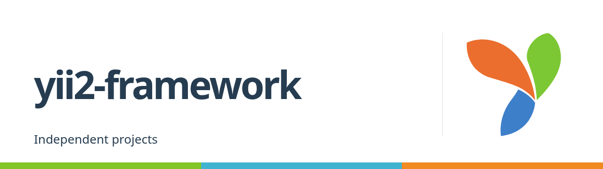

<!-- markdownlint-disable MD013 MD033 -->
<h1>
  <picture>
    <source media="(prefers-color-scheme: dark)" srcset="https://raw.githubusercontent.com/yii2-framework/.github/main/profile/assets/yii2-framework-cover-dark.png">
    <source media="(prefers-color-scheme: light)" srcset="https://raw.githubusercontent.com/yii2-framework/.github/main/profile/assets/yii2-framework-cover.png">
    
  </picture>
</h1>
<!-- markdownlint-enable MD013 MD033 -->

Independent documentation, reusable GitHub Actions, and experimental Yii2
application work.

This organization is separate from the official Yii project. Its framework
experiments are not upstream Yii releases; find the official framework at
[yiisoft/yii2](https://github.com/yiisoft/yii2).

## Documentation and contribution

The [portal's About page](https://yii2-framework.github.io/docs/about/)
explains its scope and independent status. Reuse
[GitHub Actions workflows](https://github.com/yii2-framework/actions) for PHP
repository checks.

Read the
[contribution guide](https://github.com/yii2-framework/.github/blob/main/CONTRIBUTING.md)
before proposing a change. For security concerns, follow the
[security policy](https://github.com/yii2-framework/.github/blob/main/SECURITY.md).

## Support this work

If this work is useful to you, consider
[sponsoring @terabytesoftw on GitHub](https://github.com/sponsors/terabytesoftw).
